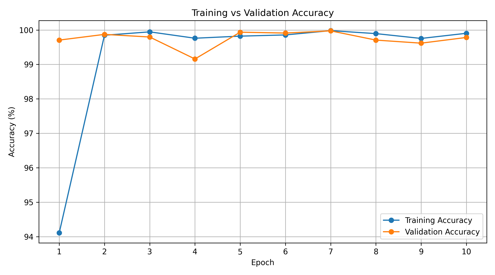
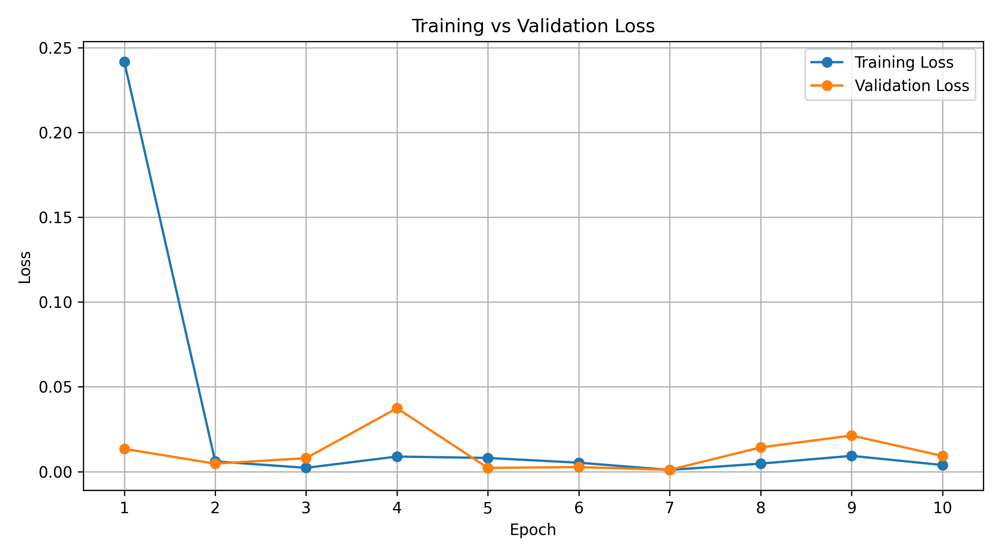

# Traffic Sign Recognition for Autonomous Vehicles

## Overview

An image classification project that uses deep learning and transfer learning to recognize German traffic signs. The project uses a pretrained ResNet18 architecture with PyTorch.

## Technologies Used

* Python
* PyTorch
* Torchvision
* NumPy
* Pandas
* Matplotlib
* Google Colab

## Dataset

German Traffic Sign Recognition Benchmark (GTSRB).

* 43 traffic sign classes
* 39,209 training images
* 12,630 official test images

## Model Architecture

ResNet18 pretrained on ImageNet, adapted for 43-class traffic sign classification.

## Results

|Metric|Score|
|-|-:|
|Test Accuracy|98.99%|
|Precision|99.19%|
|Recall|98.53%|
|F1-score|98.82%|

## Project Workflow

1. Dataset collection and exploration
2. Image preprocessing and resizing
3. Training and validation split
4. Transfer learning using pretrained ResNet18
5. Model training and optimization
6. Official test-set evaluation
7. Saving the trained model and evaluation results

## Repository Contents

* Jupyter Notebook containing implementation
* Trained model weights
* Class names
* Training history
* Evaluation results

## How to Run

Open the notebook in Google Colab, install the required dependencies, download the GTSRB dataset, and execute the cells.

## Future Improvements

* Real-time traffic sign detection using a camera
* Model deployment through an API
* Testing under different lighting and weather conditions

## Trained Model

The trained ResNet18 model is available here:

[Download traffic\_sign\_model.pth](https://drive.google.com/file/d/1oNfGxDABuFnhOp\_Rs6OY9LN9zZ5ztXMU/view?usp=sharing)

## Training Performance

The model was trained for 10 epochs using transfer learning.

### Training vs Validation Accuracy

### Training vs Validation Loss

